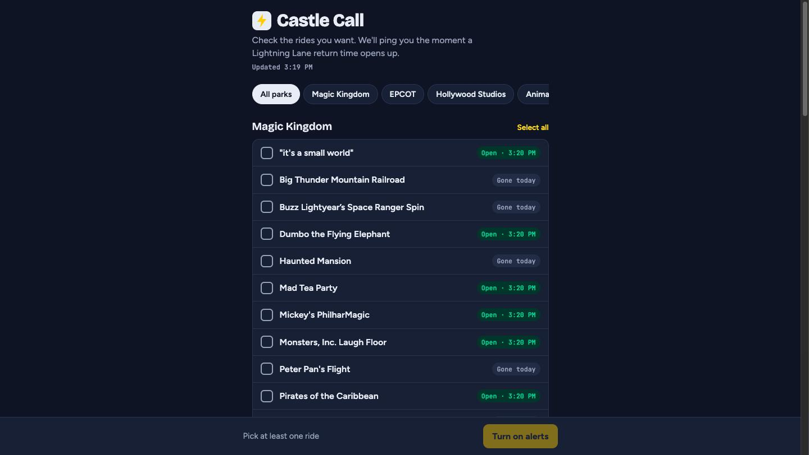

# 🏰 Castle Call

**Get a push alert the moment a Walt Disney World Lightning Lane opens up.**

Lightning Lanes for popular rides sell out early, but spots reappear throughout the day as guests change plans. Castle Call watches every ride for you and pings your phone the minute a return time opens, so you can grab it before anyone else.

**Live site:** [castlecall.onrender.com](https://castlecall.onrender.com)



## What it does

- **Pick your rides** across Magic Kingdom, EPCOT, Hollywood Studios, and Animal Kingdom with simple checkboxes.
- **Live status** on every ride: open with the next return time, full, or gone for the day, refreshed every minute.
- **Choose your window** (any time, before noon, 12–5 PM, after 5 PM) so you only hear about slots you can use.
- **Instant alerts** the moment a checked ride reopens, plus a reminder every 15 minutes while it stays open.
- **Installs like an app** on your phone's home screen, with no App Store needed.

## How it works

```
ThemeParks.wiki live data ──► Checker (every 60s) ──► Detects "full → open" ──► Web push to subscribed phones
                                     │
                                     └──► Serves the ride-picker website + live ride list
```

1. A Node.js server polls live Lightning Lane data for all four parks once a minute.
2. It remembers each ride's last status and spots the moment one flips to available.
3. It matches the opening against each user's picks and time window.
4. It sends a web push notification that links straight into the Disney app to book.

## Built with

- **Node.js + Express** for the checker and web server
- **Web Push (VAPID)** for notifications, with keys generated automatically on first start
- **Progressive Web App** (service worker + manifest) for home-screen install and iPhone alerts
- **ThemeParks.wiki API** for live park data
- **Render** for always-on hosting, deployed from this repo

## Run it locally

Requires Node 18+.

```bash
npm install
npm run dry-run   # logs alerts instead of sending them
npm start         # full mode with real push notifications
```

Then open http://localhost:3000.

### Settings

| Variable | What it does | Default |
|---|---|---|
| `REMINDER_MIN` | Minutes between "still open" reminders | `15` |
| `DATA_FILE` | Where sign-ups and push keys are saved | `./data.json` |
| `DRY_RUN` | `1` to log alerts instead of sending | off |

## API

| Route | Purpose |
|---|---|
| `GET /api/rides` | Live list of Lightning Lane rides with status |
| `GET /api/vapid-key` | Public push key for the browser |
| `POST /api/subscribe` | Save a phone's ride picks and time window |
| `POST /api/unsubscribe` | Turn off alerts |

## Notes

- Polls once a minute to stay friendly to the free community data source.
- Castle Call only alerts and links to Disney's app; it never books or logs in for you.

---

Castle Call is an independent project and is not affiliated with or endorsed by The Walt Disney Company. Live data from [ThemeParks.wiki](https://themeparks.wiki).
